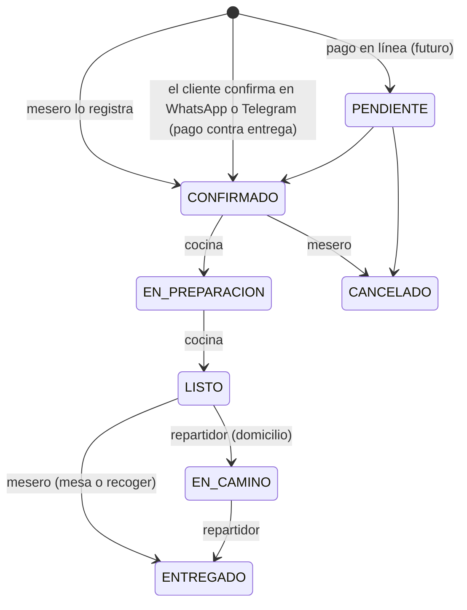

# Arquitectura

El backend es un **monolito modular**: una sola aplicación NestJS, dividida en módulos que corresponden a partes del negocio. Cada módulo solo expone lo que está en su `index.ts`, y los demás módulos no pueden usar sus archivos internos.

```
apps/
  api/   Backend NestJS (el monolito)
  web/   Aplicación web del personal (Next.js + React)
```

## Módulos del backend

| Módulo | Qué hace | Rutas |
|---|---|---|
| `identidad` | Inicio de sesión con token JWT y permisos por rol | `POST /api/auth/login`, `GET /api/auth/yo` |
| `catalogo` | Categorías y productos del menú | `/api/catalogo/categorias`, `/api/catalogo/productos` |
| `clientes` | Registro de clientes por teléfono y sus direcciones | Sin rutas propias: lo usan `pedidos` y `chatbot` |
| `pedidos` | Creación de pedidos y cambios de estado | `/api/pedidos`, `/api/mesas` |
| `chatbot` | Conversación por WhatsApp y Telegram: entiende el mensaje, arma el pedido y avisa al cliente. Ver [whatsapp.md](whatsapp.md) | `/api/webhooks/twilio`, `/api/webhooks/whatsapp`, `/api/chatbot/simulador`. Telegram no usa rutas: la API le pregunta por mensajes nuevos |
| `tiempo-real` | Avisa a la web del personal por Socket.IO | Socket en la raíz del servidor |

## Capas

Siguen la arquitectura de referencia, de afuera hacia adentro:

| Capa | Carpeta | Contenido |
|---|---|---|
| Infraestructura y adaptadores | `infrastructure/` | Controladores REST y repositorios con Prisma |
| Aplicación (casos de uso) | `application/` | `CrearPedido`, `CrearPedidoCliente`, `ActualizarEstadoPedido`, `ProcesarMensaje` |
| Dominio | `domain/` | Reglas puras: cálculo de totales, transiciones de estado, permisos por rol, NLP por reglas y pasos del diálogo |

El dominio no conoce la base de datos ni HTTP, por eso se prueba sin ellos. El módulo `pedidos` accede a los datos a través de un puerto (`PedidoRepository`), con una implementación en Prisma. El catálogo es CRUD sin reglas complejas y usa Prisma directamente. El chatbot recibe por puertos los emisores de WhatsApp y Telegram y el motor de NLP, y el `.env` elige la implementación.

## Eventos entre módulos

Los módulos se avisan por un bus de eventos en memoria (`shared/eventos.ts`), sin depender uno del otro:

| Evento | Lo publica | Lo escuchan |
|---|---|---|
| `pedido.creado` | `pedidos` | `tiempo-real` (la web se actualiza) |
| `pedido.estado_cambiado` | `pedidos` | `tiempo-real` y `chatbot` (le escribe al cliente) |

El bus vive dentro del proceso. Si la API corre en varios servidores, habría que cambiarlo por uno externo, como Redis.

## Estados del pedido



Un pedido no se puede cancelar una vez entra a preparación. Si dos personas cambian el mismo pedido a la vez, solo se aplica el primer cambio.

## Pendiente para las siguientes etapas

- **Pagos en línea:** por ahora el pago es contra entrega.
- **Inventario y analítica:** las tablas ya existen. Faltan sus pantallas.
