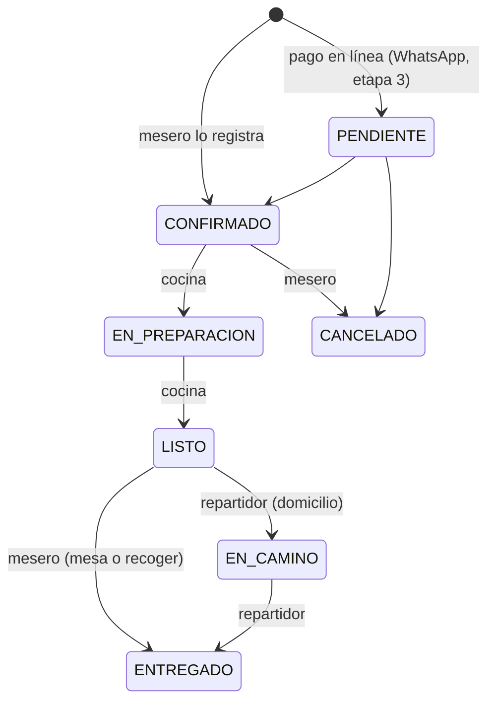

# Arquitectura

El backend es un **monolito modular**: una sola aplicación NestJS, dividida en módulos que corresponden a partes del negocio. Cada módulo solo expone lo que está en su `index.ts`, y los demás módulos no pueden usar sus archivos internos.

```
apps/
  api/   Backend NestJS (el monolito)
  web/   Aplicación web del personal (Next.js + React)
```

## Módulos del backend

| Módulo | Qué hace | Rutas |
|---|---|---|
| `identidad` | Inicio de sesión con token JWT y permisos por rol | `POST /api/auth/login`, `GET /api/auth/yo` |
| `catalogo` | Categorías y productos del menú | `/api/catalogo/categorias`, `/api/catalogo/productos` |
| `clientes` | Registro de clientes por teléfono | Sin rutas propias: lo usa `pedidos` |
| `pedidos` | Creación de pedidos y cambios de estado | `/api/pedidos`, `/api/mesas` |

## Capas

Siguen la arquitectura de referencia, de afuera hacia adentro:

| Capa | Carpeta | Contenido |
|---|---|---|
| Infraestructura y adaptadores | `infrastructure/` | Controladores REST y repositorios con Prisma |
| Aplicación (casos de uso) | `application/` | `CrearPedido`, `ActualizarEstadoPedido` |
| Dominio | `domain/` | Reglas puras: cálculo de totales, transiciones de estado y permisos por rol |

El dominio no conoce la base de datos ni HTTP, por eso se prueba sin ellos. El módulo `pedidos` accede a los datos a través de un puerto (`PedidoRepository`), con una implementación en Prisma. El catálogo es CRUD sin reglas complejas y usa Prisma directamente.

## Estados del pedido



Un pedido no se puede cancelar una vez entra a preparación. Si dos personas cambian el mismo pedido a la vez, solo se aplica el primer cambio.

## Pendiente para las siguientes etapas

- **Tiempo real:** la cocina y el tablero se actualizan cada 5 segundos. Con el chatbot de WhatsApp llegarán el bus de eventos y Socket.IO, para avisar al instante.
- **Domicilios, entregas y pagos:** llegan con el chatbot, que es el canal que los genera.
- **Inventario y analítica:** las tablas ya existen. Faltan sus pantallas.
