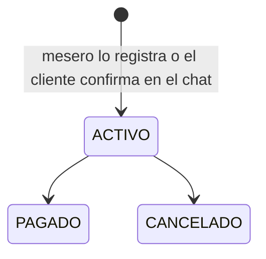

# Arquitectura

El backend es un **monolito modular**: una sola aplicación NestJS, dividida en módulos que corresponden a partes del negocio. Cada módulo solo expone lo que está en su `index.ts`, y los demás módulos no pueden usar sus archivos internos.

```
apps/
  api/   Backend NestJS (el monolito)
  web/     Aplicación web del personal (Next.js + React)
  mobile/  App Android de meseros y repartidores (React Native + Expo). Usa la misma API
```

## Módulos del backend

| Módulo | Qué hace | Rutas |
|---|---|---|
| `identidad` | Inicio de sesión con token JWT, permisos por rol y cuentas del personal | `POST /api/auth/login`, `GET /api/auth/yo`, `/api/personal` (el administrador crea, edita, suspende y borra meseros y repartidores) |
| `catalogo` | Categorías y productos del menú | `/api/catalogo/categorias`, `/api/catalogo/productos` |
| `clientes` | Registro de clientes por teléfono y sus direcciones | Sin rutas propias: lo usan `pedidos` y `chatbot` |
| `pedidos` | Creación de pedidos, cierre (pagado o cancelado), toma de domicilios y mesas | `/api/pedidos`, `/api/pedidos/:id/estado`, `/api/pedidos/:id/tomar`, `/api/mesas` (el administrador las crea, edita, suspende y borra), `/api/estadisticas/dia?fecha=AAAA-MM-DD` (lo vendido, los cancelados, lo más vendido, las ventas por canal y las horas pico del día, solo el administrador) |
| `chatbot` | Conversación por WhatsApp y Telegram: entiende el mensaje, arma el pedido y avisa al cliente. Ver [whatsapp.md](whatsapp.md) | `/api/webhooks/twilio`, `/api/webhooks/whatsapp`. Telegram no usa rutas: la API le pregunta por mensajes nuevos |
| `pagos` | Pago en línea con MercadoPago: crea el enlace de pago y confirma los pagos que avisa MercadoPago. Ver [pagos.md](pagos.md) | `/api/webhooks/mercadopago`. El enlace lo pide el `chatbot` |
| `tiempo-real` | Avisa a la web del personal por Socket.IO | Socket en la raíz del servidor |

## Capas

Siguen la arquitectura de referencia, de afuera hacia adentro:

| Capa | Carpeta | Contenido |
|---|---|---|
| Infraestructura y adaptadores | `infrastructure/` | Controladores REST y repositorios con Prisma |
| Aplicación (casos de uso) | `application/` | `CrearPedido`, `CrearPedidoCliente`, `ActualizarEstadoPedido`, `ProcesarMensaje`, `CrearEnlacePago`, `ProcesarNotificacion` |
| Dominio | `domain/` | Reglas puras: cálculo de totales, quién puede cerrar o tomar cada pedido, NLP por reglas, pasos del diálogo y cuándo un aviso de pago cambia el pago |

El dominio no conoce la base de datos ni HTTP, por eso se prueba sin ellos. El módulo `pedidos` accede a los datos a través de un puerto (`PedidoRepository`), con una implementación en Prisma. El módulo `pagos` tiene dos puertos: `PagoRepository` (Prisma) y `Pasarela` (MercadoPago, o una pasarela falsa en las pruebas); no depende de `pedidos`, porque quien pide el enlace le pasa el número y el total del pedido. El catálogo es CRUD sin reglas complejas y usa Prisma directamente. El chatbot recibe por puertos los emisores de WhatsApp y Telegram y el motor de NLP, y el `.env` elige la implementación.

## Eventos entre módulos

Los módulos se avisan por un bus de eventos en memoria (`shared/eventos.ts`), sin depender uno del otro:

| Evento | Lo publica | Lo escuchan |
|---|---|---|
| `pedido.creado` | `pedidos` | `tiempo-real` (la web se actualiza) |
| `pedido.estado_cambiado` | `pedidos` | `tiempo-real` y `chatbot` (le escribe al cliente) |
| `pedido.en_camino` | `pedidos`, cuando un repartidor toma un domicilio | `tiempo-real` y `chatbot` (avisa que va en camino) |
| `pago.estado_cambiado` | `pagos`, cuando MercadoPago aprueba, rechaza o reembolsa un pago | `tiempo-real` (la tarjeta muestra si ya está pagado) y `chatbot` (le escribe al cliente) |

El bus vive dentro del proceso. Si la API corre en varios servidores, habría que cambiarlo por uno externo, como Redis.

## Estados del pedido



Un domicilio sigue **Activo** mientras va en camino: al tomarlo, queda a nombre del repartidor y el cliente recibe el aviso. Quién puede cerrar cada pedido:

| Pedido | Lo marca pagado o cancelado |
|---|---|
| De mesa o para recoger, registrado por un mesero | Ese mesero |
| Para recoger, llegado por el chatbot | El administrador |
| Domicilio | El repartidor que lo tomó |

El administrador puede cerrar cualquiera. Un pedido pagado o cancelado ya no cambia.

**Qué ve cada rol** (lo decide la API, en `alcanceDe` del dominio): el administrador, todos los pedidos; el mesero, solo los que registró; el repartidor, los domicilios que nadie ha tomado y los que lleva él, y en el historial, solo los que llevó. `GET /api/pedidos` devuelve los activos y `GET /api/pedidos?estados=PAGADO,CANCELADO` los cerrados hoy (hora de Colombia). Un pedido que el usuario no puede ver responde 404. Si dos personas cierran o toman el mismo pedido a la vez, solo se aplica el primer cambio.

## Pendiente para las siguientes etapas

- **Pagos en línea:** funcionan desde el chatbot ([pagos.md](pagos.md)). Faltan los reembolsos al cancelar y pedir un enlace nuevo cuando vence.
- **Inventario y analítica:** las tablas ya existen. Faltan sus pantallas.
