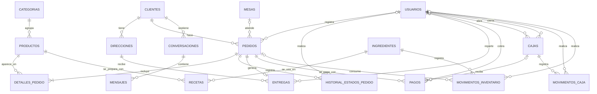

# Base de datos

Corresponde a la Fase 2 de la guía metodológica. El esquema está en [`schema.prisma`](../apps/api/prisma/schema.prisma), y el diagrama editable, en [`modelo-er.drawio`](modelo-er.drawio), que se abre en [app.diagrams.net](https://app.diagrams.net). Si cambia el esquema, se regenera con `node scripts/generar-er-drawio.mjs`.

## Tablas por módulo

| Módulo | Tablas | Qué guarda |
|---|---|---|
| Personal | `usuarios` | Administradores, meseros y repartidores, con su rol |
| Clientes | `clientes`, `direcciones` | El cliente se identifica por teléfono y puede tener varias direcciones |
| Catálogo | `categorias`, `productos` | El menú, con sinónimos para que el chatbot reconozca los productos |
| Pedidos | `mesas`, `pedidos`, `detalles_pedido`, `historial_estados_pedido` | Pedidos de los tres canales, y quién cambió cada estado y cuándo. Cada mesa tiene tipo (`NORMAL`, `LARGA`, `AFUERA`) y número; su código es la abreviatura más el número (M3, L1, AF2), y el número se repite entre tipos |
| Entregas | `entregas` | Dirección, repartidor y estado de cada domicilio |
| Pagos | `pagos` | Efectivo, tarjeta, transferencia o pasarela en línea, con la caja en la que entró y quién lo cobró |
| Caja | `cajas`, `movimientos_caja` | Cada turno de caja: base, quién la abrió y la cerró, el efectivo esperado y el contado, y las entradas y salidas de efectivo |
| Chatbot | `conversaciones`, `mensajes` | En qué paso va cada cliente en cada canal (WhatsApp o Telegram), lo que lleva pedido y los mensajes |
| Inventario (opcional) | `ingredientes`, `recetas`, `movimientos_inventario` | Stock, consumo por producto y cada entrada o salida |
| Integración | `eventos_outbox` | Eventos pendientes de publicar en el bus, como `PEDIDO_CONFIRMADO` |

El módulo analítico no necesita tablas propias: el dashboard calcula ventas, productos más vendidos y horas pico desde `pedidos` y `detalles_pedido`.

## Diagrama entidad-relación



## Decisiones de diseño

- **Ventas que no cambian:** `detalles_pedido` copia el nombre y el precio, y `entregas` copia la dirección. Editar el menú o una dirección no altera lo ya vendido.
- **Stock trazable:** el stock se actualiza con un trigger cada vez que se registra un movimiento. Los movimientos no se editan ni se borran: un error se corrige con un `AJUSTE`.
- **Reintentos sin duplicados:** WhatsApp y las pasarelas repiten sus notificaciones. Lo impiden `wa_message_id` (guarda el identificador del mensaje en WhatsApp o Telegram), `clave_idempotencia` y `referencia_externa`, que son únicos.
- **Reglas en la base de datos:** el total debe ser subtotal más domicilio, un pedido de mesa necesita mesa, un domicilio necesita cliente y un pedido no admite dos pagos aprobados. Están en la migración `reglas_integridad`.
- **Una sola caja abierta:** un índice único parcial sobre `cajas` (solo las que no tienen `cerrada_en`) impide abrir dos a la vez. Al cerrar se guarda el efectivo esperado (base + efectivo cobrado + entradas − salidas) junto al contado, para ver el sobrante o el faltante.
- **Fechas:** se guardan con zona horaria (`timestamptz`), y la hora de Colombia se calcula al mostrarlas.
- **Identificadores:** UUID generados por PostgreSQL. `pedidos.numero` es el número corto que ven el cliente y el personal.

## Conectar con Supabase

1. Crea un proyecto en [supabase.com](https://supabase.com) y guarda la contraseña de la base de datos.
2. Pulsa **Connect** y copia la cadena de **Session pooler**, la del puerto `5432`. Esta conexión funciona con IPv4, y la API correrá como un proceso permanente, que es el caso para el que Supabase la recomienda.
3. Copia `apps/api/.env.example` como `apps/api/.env` y completa `DATABASE_URL` y las dos contraseñas del seed. Si la contraseña de la base de datos tiene caracteres como `@` o `#`, escríbelos codificados para URL (`@` es `%40`).
4. Instala las dependencias fuera de OneDrive, que suele bloquear `node_modules`. Desde `apps/api`:

```bash
npm ci
```

```bash
npm run db:migrate
```

```bash
npm run db:seed
```

5. Verifica en Supabase que **Table Editor** muestre las 17 tablas más `_prisma_migrations`, y que **Advisors > Security** no avise de tablas sin RLS.

## Seguridad

Supabase expone el esquema `public` con una API que acepta la clave pública del proyecto. Por eso, la migración `cerrar_api_supabase` activa RLS en todas las tablas y retira los permisos de `anon` y `authenticated`.

El backend entra como `postgres`, dueño de las tablas, y no se ve afectado. Las aplicaciones web y móvil no deben usar `supabase-js` para leer datos: siempre pasan por la API. Antes de producción, conviene conectar el backend con un usuario propio en lugar de `postgres`.
