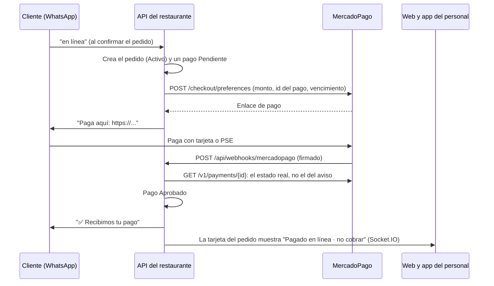

# Pago en línea con MercadoPago

El cliente que pide por WhatsApp o Telegram puede pagar en efectivo al recibir o en línea, con tarjeta o PSE, en la página de pago de MercadoPago (Checkout Pro). El sistema no muestra ni guarda datos de tarjetas: solo crea el enlace de pago y recibe el aviso cuando el pago se aprueba.

Sin credenciales de MercadoPago, el pago en línea queda apagado y el bot solo ofrece efectivo, como antes.

## Cómo funciona



El pedido sigue **Activo** después de pagarse en línea: el personal lo cierra como **Pagado** al entregarlo, sin cobrar. Así no cambian los estados del pedido ni quién puede cerrarlo (ver [arquitectura.md](arquitectura.md)).

## El módulo `pagos`

| Capa | Archivo | Qué hace |
|---|---|---|
| Dominio | `domain/pago.ts` | Traduce los estados de MercadoPago y decide si un aviso cambia el pago: los avisos llegan repetidos y en desorden, un rechazo viejo no deshace un pago aprobado, y no se aprueba un monto o una moneda distintos |
| Aplicación | `application/crear-enlace-pago.use-case.ts` | Crea el enlace. Si el pedido ya tiene uno pendiente y vigente, devuelve ese |
| Aplicación | `application/procesar-notificacion.use-case.ts` | Atiende el aviso: consulta el pago, aplica las reglas, guarda el cambio y publica `pago.estado_cambiado` |
| Aplicación | `application/pasarela.ts`, `application/pago.repository.ts` | Puertos: los casos de uso no conocen MercadoPago ni Prisma |
| Infraestructura | `infrastructure/mercadopago.pasarela.ts` | Llama a la API de MercadoPago con `fetch` |
| Infraestructura | `infrastructure/firma-mercadopago.ts` | Valida la cabecera `x-signature` (HMAC-SHA256), igual que el SDK oficial |
| Infraestructura | `infrastructure/webhook-mercadopago.controller.ts` | `POST /api/webhooks/mercadopago` |

El webhook procesa el aviso antes de responder. Si algo falla, responde con error y MercadoPago lo reenvía más tarde. Si respondiera 200 de inmediato y fallara después, el pago quedaría sin confirmar.

El pago se guarda en la tabla `pagos`, que ya existía: `metodo = ONLINE`, `estado`, `monto`, `proveedor = mercadopago`, `referencia_externa` (el id de la preferencia) y `url_pago`.

## Configurarlo

### 1. Crear la aplicación en MercadoPago

1. Entra a [mercadopago.com.co/developers](https://www.mercadopago.com.co/developers) con tu cuenta de MercadoPago y abre **Tus integraciones**.
2. **Crear aplicación**, y elige el producto **Checkout Pro**.
3. En la aplicación, abre **Cuentas de prueba** y crea dos: una **vendedora** y una **compradora**, las dos de Colombia. No se puede pagar con la misma cuenta que cobra.
4. Copia el **Access Token de prueba** (credenciales de prueba).

### 2. Variables de la API

En `apps/api/.env` (o en Render):

```env
MERCADOPAGO_ACCESS_TOKEN="el Access Token de prueba"
MERCADOPAGO_WEBHOOK_SECRET="la clave secreta del paso 3"
API_PUBLIC_URL="https://la-direccion-publica-de-la-api"
```

Si hay token y falta la clave secreta, la API no arranca y lo explica. Sin `API_PUBLIC_URL`, MercadoPago usa la dirección configurada en su panel.

### 3. Registrar el webhook

MercadoPago tiene que poder llamar a la API desde internet, así que `localhost` no sirve.

- **En Render:** la dirección es `https://TU-API.onrender.com/api/webhooks/mercadopago`. Render ya define `RENDER_EXTERNAL_URL`, así que `API_PUBLIC_URL` no hace falta.
- **En tu PC:** abre un túnel con [cloudflared](https://developers.cloudflare.com/cloudflare-one/connections/connect-networks/downloads/) mientras corre la API:
  ```bash
  cloudflared tunnel --url http://localhost:4000
  ```
  Copia la dirección `https://….trycloudflare.com` que muestra, ponla en `API_PUBLIC_URL` y reinicia la API. La dirección cambia cada vez que abres el túnel.

En **Tus integraciones > tu aplicación > Webhooks**, registra `https://…/api/webhooks/mercadopago`, marca el evento **Pagos** y guarda. MercadoPago muestra la **clave secreta**: cópiala en `MERCADOPAGO_WEBHOOK_SECRET`.

### 4. Probar un pago

1. Escríbele al bot (por Telegram es lo más fácil, ver [whatsapp.md](whatsapp.md)), arma un pedido y responde **en línea** en la confirmación.
2. Abre el enlace **en una ventana de incógnito** e inicia sesión con la **cuenta compradora** de prueba.
3. Paga con una de las tarjetas de prueba de la documentación de MercadoPago ("Realizar compras de prueba"). El **nombre del titular** decide el resultado:
   - `APRO`: pago aprobado. El bot responde "✅ Recibimos tu pago" y la tarjeta del pedido muestra "Pagado en línea".
   - `OTHE`: rechazado. El bot ofrece intentarlo otra vez o pagar en efectivo.
   - `CONT`: queda pendiente.

Si el pago no se confirma, revisa el registro de la API: un aviso rechazado deja la línea `Aviso de MercadoPago rechazado` con el motivo (casi siempre, una clave secreta que no coincide con la del panel), y los avisos que no cambian nada quedan anotados con su motivo.

Cuidados al probar:

- **Correo al pagar:** usa siempre el de la **cuenta compradora de prueba**. MercadoPago bloquea los correos y las cuentas reales en el modo de prueba.
- **Túnel:** cada enlace guarda la dirección del aviso del momento en que se creó. Si el túnel se reinicia, la dirección cambia y los enlaces anteriores avisan a la dirección vieja: actualiza `API_PUBLIC_URL` y la URL del panel, reinicia la API y crea un pedido nuevo.

## Pruebas automáticas

En `apps/api`, sin MercadoPago ni internet:

- `npm test`: las reglas del pago, la firma, el adaptador (con `fetch` reemplazado) y el diálogo del bot.
- `npm run test:e2e`: `test/pagos.e2e.ts` reemplaza MercadoPago por una pasarela falsa. Prueba el enlace, el webhook firmado, los avisos repetidos, los montos que no coinciden y la conversación completa por WhatsApp.

## Limitaciones

- **Reembolsos:** cancelar un pedido pagado en línea no devuelve el dinero. El reembolso se hace desde el panel de MercadoPago; el sistema lo registra cuando llega el aviso.
- **Enlace vencido:** el enlace vale 30 minutos. Después, el cliente paga en efectivo; todavía no puede pedir un enlace nuevo por el chat.
- **Regreso al chat:** al terminar de pagar, el cliente queda en la página de MercadoPago (no se configuraron `back_urls`). El aviso de pago le llega por el chat.
