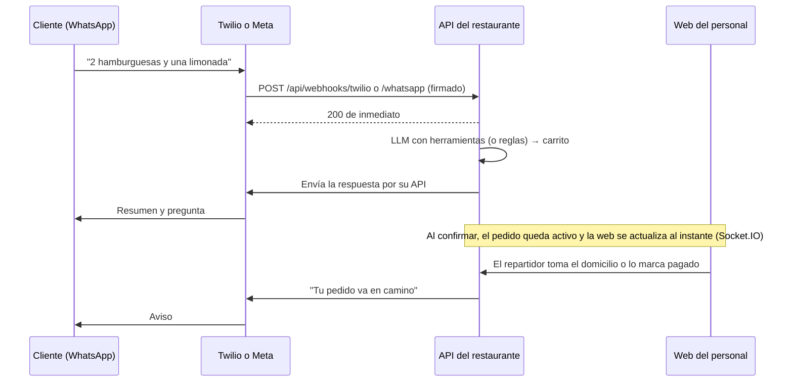

# Chatbot de WhatsApp y Telegram

El bot toma pedidos por WhatsApp y por Telegram: entiende lo que escribe el cliente, arma el pedido con los productos del menú, pregunta si es a domicilio o para recoger, confirma el total y registra el pedido. Después le avisa al cliente cuando el domicilio sale, cuando se entrega o si se cancela.

## Cómo funciona



El módulo `chatbot` tiene las mismas capas que el resto del monolito:

| Capa | Archivo | Qué hace |
|---|---|---|
| Dominio | `domain/agente.ts` | Las instrucciones y las herramientas del LLM (agregar, quitar, entrega, pago, resumen, confirmar, cancelar). Cada herramienta valida contra el menú real |
| Dominio | `domain/nlu-reglas.ts` | Respaldo sin LLM: entiende el mensaje con reglas (productos, cantidades, notas e intención) |
| Dominio | `domain/dialogo.ts` | Respaldo sin LLM: los pasos fijos de la conversación. También da el resumen oficial con el total |
| Aplicación | `application/procesar-mensaje.use-case.ts` | Guarda el mensaje, se lo pasa al LLM (o a las reglas si no responde), crea el pedido y responde |
| Aplicación | `application/notificar-cliente.ts` | Escucha los cambios de estado y le escribe al cliente por el canal en que pidió |
| Aplicación | `application/recibir-telegram.use-case.ts` | En Telegram, pide el número del cliente la primera vez y luego pasa cada mensaje al bot |
| Infraestructura | `infrastructure/webhook-twilio.controller.ts` | Recibe los avisos de Twilio y valida su firma |
| Infraestructura | `infrastructure/webhook-whatsapp.controller.ts` | Recibe los avisos de Meta y valida su firma |
| Infraestructura | `infrastructure/emisores.ts` | Envía por Twilio o por Meta, o no envía nada en modo simulado |
| Infraestructura | `infrastructure/telegram.ts` | Recibe los mensajes de Telegram (sondeo) y envía las respuestas |
| Infraestructura | `infrastructure/agente-claude.ts` | El LLM con Claude (SDK de Anthropic) |
| Infraestructura | `infrastructure/agente-openai.ts` | El LLM con OpenAI (API de Responses) |
| Infraestructura | `infrastructure/agente-chat-completions.ts` | El LLM con Groq, gratis. Sirve para cualquier API compatible con Chat Completions |
| Infraestructura | `infrastructure/motores-nlp.ts` | Motor de reglas, el respaldo |

Los precios y los productos siempre salen de la base de datos. El LLM conversa, pero solo cambia el pedido llamando a las herramientas, que buscan cada producto en el menú y usan su precio real. El total que ve el cliente lo escribe el código, no el modelo.

## Elegir cómo funciona, desde el `.env`

| Variable | Valores | Para qué |
|---|---|---|
| `WHATSAPP_PROVIDER` | `simulado` (por defecto), `twilio` o `meta` | Con `simulado` WhatsApp queda sin conectar y no se envía nada. Con `twilio` o `meta` responde por WhatsApp real |
| `TELEGRAM_BOT_TOKEN` | El token de @BotFather, o vacío | Con token, el bot también atiende por Telegram. Funciona junto a cualquier valor de `WHATSAPP_PROVIDER` |
| `NLP_PROVIDER` | `reglas` (por defecto), `groq`, `claude` u `openai` | Con `groq`, `claude` u `openai`, un LLM atiende la conversación y responde preguntas libres. Si falla o tarda más de 25 segundos, responden las reglas |
| `COSTO_DOMICILIO` | Pesos, por ejemplo `5000` | Se suma a los pedidos a domicilio |

Cambiar de proveedor no requiere tocar código: solo el `.env` y reiniciar la API.

## Probarlo sin WhatsApp

La forma más fácil de probar el bot es Telegram: solo necesita el token de un bot (ver la sección siguiente). Los pedidos que confirmes son reales: aparecen en **Pedidos**, y al cobrarlos o cancelarlos el bot avisa en el chat.

## Conectarlo a Telegram (lo más fácil)

Telegram no pide aprobar ningún negocio, es gratis y no necesita ngrok: la API le pregunta a Telegram cada pocos segundos si hay mensajes nuevos.

### 1. Crear el bot

1. En Telegram, busca **@BotFather** (tiene la insignia de verificado) y envíale `/newbot`.
2. Escribe el nombre que verán los clientes, por ejemplo *Restaurante Pedidos*.
3. Escribe un usuario que termine en `bot`, por ejemplo `restaurante_pedidos_bot`.
4. BotFather te responde con un **token**, parecido a `123456789:AA…`. Es secreto: quien lo tenga controla el bot.

### 2. Preparar la base de datos (una sola vez)

Telegram necesita dos columnas nuevas. En `apps/api`:

```bash
npm run db:migrate
```

La migración `canal_telegram` solo agrega columnas y un valor nuevo; no borra ni cambia datos.

### 3. Completar el `.env` y encender la API

```env
TELEGRAM_BOT_TOKEN="123456789:AA..."
```

Reinicia la API. En la terminal debe aparecer `Bot de Telegram @tu_bot escuchando mensajes`.

### 4. Probar

1. Abre `t.me/tu_bot` o búscalo en Telegram y pulsa **Iniciar**.
2. La primera vez, el bot pide tu número: toca **📱 Compartir mi número**. Así el sistema te registra como cliente, igual que por WhatsApp.
3. Pide: *2 hamburguesas y una limonada*, *listo*, *a domicilio*, tu dirección, *sí*.

El pedido aparece en **Pedidos** con el canal *Telegram*, y los avisos de estado llegan al chat.

| Mensaje en la API | Causa |
|---|---|
| `No se pudo conectar con Telegram` | El token está mal copiado o fue revocado en @BotFather |
| `Otra API está recibiendo los mensajes de este bot` | Hay dos copias de la API encendidas con el mismo token. Deja solo una |

En producción, con `TELEGRAM_WEBHOOK_SECRET`, Telegram entrega los mensajes por webhook. Ver [despliegue.md](despliegue.md). No uses el mismo token en tu PC y en producción a la vez: crea otro bot para desarrollar.

## Conectarlo a WhatsApp con Twilio

Twilio es un proveedor oficial de WhatsApp. Su **Sandbox** sirve para probar sin verificar ningún negocio ante Meta. Esto lo haces tú con tu cuenta de Twilio; los nombres de los menús pueden cambiar con el tiempo.

### 1. Activar el Sandbox

1. Crea una cuenta en [twilio.com](https://www.twilio.com) y confirma tu correo y tu celular. La cuenta de prueba trae crédito gratis.
2. El Sandbox solo existe en la **consola antigua** de Twilio; la consola nueva no muestra la opción. Ábrelo directo en [twilio.com/console/sms/whatsapp/sandbox](https://www.twilio.com/console/sms/whatsapp/sandbox), acepta los términos y pulsa **Confirm**.
3. Verás el número del Sandbox (`+1 415 523 8886`) y un código como `join palabra-palabra`. Desde tu WhatsApp, envíale ese código a ese número. Cada persona que vaya a probar el bot debe hacer lo mismo.

### 2. Completar el `.env` de la API

```env
WHATSAPP_PROVIDER="twilio"
TWILIO_ACCOUNT_SID="..."     # Consola de Twilio > Account Info
TWILIO_AUTH_TOKEN="..."      # En el mismo lugar. Es secreto: no lo compartas
TWILIO_WHATSAPP_NUMBER="+14155238886"
```

Reinicia la API después de cambiar el `.env`.

### 3. Exponer la API y registrar el webhook

1. Abre el túnel: `ngrok http 4000`.
2. En la misma página del Sandbox (consola antigua), pestaña **Sandbox settings**, sección **Sandbox configuration**, en **When a message comes in**, pega `https://TU-DIRECCION/api/webhooks/twilio` con el método **POST**, y guarda.

Si el enlace te lleva a la consola nueva, usa en cambio **Try out WhatsApp** (inicio de la consola, **Try it out > Communications > Send a WhatsApp message**): pestaña **Inbound**, **Auto-Reply settings > Custom**, y ahí pon la misma URL. Según Twilio, esa prueba de la consola nueva limita los mensajes que se envían por la API a plantillas aprobadas; si las respuestas del bot fallan, revisa el error en los registros de Twilio.

### 4. Probar

Escríbele "hola" al número del Sandbox desde un celular que ya envió el código `join`. Si no responde, revisa la terminal de la API:

| Mensaje en la API | Causa |
|---|---|
| `Firma inválida` (403) | `TWILIO_AUTH_TOKEN` no es el de la cuenta, o la URL que calcula la API no es la registrada. Pon en `TWILIO_WEBHOOK_URL` la misma URL que pegaste en Twilio |
| `Twilio respondió 401` | `TWILIO_ACCOUNT_SID` o `TWILIO_AUTH_TOKEN` están mal |
| `Twilio respondió 400` | El número no se unió al Sandbox, o pasaron más de 24 horas desde su último mensaje |
| Nada | La URL del Sandbox está mal, no es POST, o el túnel de ngrok está cerrado |

En la consola de Twilio, **Monitor > Logs > Messaging**, puedes ver cada mensaje y su error.

**Límites del Sandbox:** solo le responde a quien envió el código `join`, y esa unión vence a los pocos días (se vuelve a enviar el código). Los mensajes salen del número compartido de Twilio. Para un número propio del restaurante, Twilio pide registrar un remitente de WhatsApp, lo que de nuevo pasa por la aprobación de Meta.

## Conectarlo directo con Meta

Esto lo haces tú con tu cuenta de Meta. Meta puede exigir que el portafolio de negocio tenga datos de contacto completos, o incluso la verificación del negocio, antes de dejarte terminar. Los nombres de los menús de Meta cambian con el tiempo; si alguno no coincide, busca la opción equivalente.

### 1. Crear la app en Meta

1. Entra a [developers.facebook.com](https://developers.facebook.com), **Mis apps**, **Crear app**.
2. Elige el caso de uso de WhatsApp (conectar con clientes por WhatsApp) y asóciala a un portafolio de negocio.
3. En **WhatsApp > Configuración de la API** verás un **número de prueba** que Meta te presta, su **identificador del número de teléfono** y un **token de acceso temporal** (dura 24 horas).
4. En la misma página, en **Para**, agrega tu celular y los de quienes van a probar (hasta 5) y confírmalos con el código que llega por WhatsApp. Con el número de prueba, el bot solo puede escribirles a esos números.

### 2. Completar el `.env` de la API

```env
WHATSAPP_PROVIDER="meta"
META_VERIFY_TOKEN="una-frase-que-inventes"
META_APP_SECRET="..."        # Configuración de la app > Básica > Clave secreta de la app
META_ACCESS_TOKEN="..."      # El token de WhatsApp > Configuración de la API
META_PHONE_NUMBER_ID="..."   # El identificador del número de teléfono (no es el número)
```

`.env` nunca se sube a GitHub. No compartas estos valores por chat.

### 3. Exponer la API a internet

Meta necesita una dirección pública con HTTPS. Mientras desarrollas, usa un túnel como [ngrok](https://ngrok.com):

```bash
ngrok http 4000
```

ngrok te da una dirección como `https://abcd-1234.ngrok-free.app`. Cuando la API esté desplegada (etapa 5), usarás la dirección del servidor.

### 4. Registrar el webhook

1. En Meta, **WhatsApp > Configuración**, sección **Webhook**, pulsa **Editar**.
2. **URL de devolución de llamada:** `https://TU-DIRECCION/api/webhooks/whatsapp`
3. **Token de verificación:** el mismo `META_VERIFY_TOKEN` del `.env`.
4. Pulsa **Verificar y guardar**. La API debe estar encendida: Meta la llama para comprobarla.
5. En **Campos del webhook**, suscríbete a **messages**.

### 5. Probar

Desde un celular autorizado, escríbele "hola" al número de prueba. Si no responde, revisa la terminal de la API:

| Mensaje en la API | Causa |
|---|---|
| `Firma inválida` (403) | `META_APP_SECRET` no corresponde a la app |
| `Meta respondió 401` | El token venció. El temporal dura 24 horas |
| `Meta respondió 400` con *recipient* | El número no está en la lista **Para** |
| Nada | El webhook no está suscrito a **messages**, o el túnel cambió de dirección |

### 6. Token permanente

El token temporal vence cada día. Para uno que no venza: en la configuración del negocio de Meta, **Usuarios del sistema**, crea un usuario administrador, asígnale la app y genera un token con los permisos `whatsapp_business_messaging` y `whatsapp_business_management`.

## Atender con un LLM (Claude u OpenAI)

Con un LLM, el bot conversa como una persona: responde "¿qué me recomiendas?" o "¿la hamburguesa trae papas?" con la información del menú, entiende pedidos escritos de cualquier forma y no obliga a usar palabras como *listo*.

**Con Groq (plan gratuito):** crea una cuenta y una clave en [console.groq.com](https://console.groq.com), sin tarjeta, y en el `.env`:

```env
NLP_PROVIDER="groq"
GROQ_API_KEY="gsk_..."
GROQ_MODEL=""   # Vacío usa openai/gpt-oss-120b
```

El plan gratuito tiene límites por minuto y por día; los de tu cuenta están en *Settings → Limits* de la consola. Cada mensaje del cliente gasta de 1 a 3 peticiones. Si se acaba el cupo, Groq responde 429 y ese mensaje lo atienden las reglas, sin cortar la conversación.

**Con Claude:** crea una clave en [console.anthropic.com](https://console.anthropic.com) y en el `.env`:

```env
NLP_PROVIDER="claude"
ANTHROPIC_API_KEY="..."
ANTHROPIC_MODEL=""   # Vacío usa claude-opus-5-5
```

**Con OpenAI:** crea una clave en [platform.openai.com](https://platform.openai.com) y en el `.env`:

```env
NLP_PROVIDER="openai"
OPENAI_API_KEY="..."
OPENAI_MODEL="..."   # Un modelo actual que admita llamadas a funciones
```

Cómo funciona cada mensaje:

1. El LLM recibe las instrucciones fijas (`INSTRUCCIONES_AGENTE`), el menú con precios, el pedido en curso y los últimos 20 mensajes de las 6 horas anteriores.
2. Para cambiar el pedido llama a las herramientas de `domain/agente.ts`. Cada una valida contra el menú y le responde qué pasó; el modelo puede llamar varias antes de contestar (máximo 6 vueltas).
3. `mostrar_resumen` envía el resumen oficial con el total, escrito por el código. `confirmar_pedido` solo funciona si el cliente ya vio ese resumen y el pedido no cambió después.
4. Si el proveedor falla, rechaza el mensaje o tarda más de 25 segundos, ese mensaje lo atienden las reglas desde el mismo paso.

En la tabla `mensajes`, la columna `intencion` vale `llm` cuando respondió el LLM, o la intención de las reglas cuando respondieron ellas.

Cada mensaje del cliente es una o varias consultas al proveedor, con su costo. Claude responde con esfuerzo bajo (`effort: low`) para que la conversación sea rápida, y guarda en caché las instrucciones fijas. Si Claude rechaza un mensaje por seguridad, el servidor lo reintenta con otro modelo en la misma llamada (`fallbacks: "default"`).

## Seguridad y límites

- Cada aviso se valida con la firma del proveedor: `X-Twilio-Signature` con el Auth Token de Twilio, o `X-Hub-Signature-256` con la clave secreta de la app de Meta. Sin esos secretos, el webhook correspondiente rechaza todo.
- Meta y Twilio pueden enviar un aviso más de una vez. El bot guarda el identificador de cada mensaje y no procesa dos veces el mismo, ni crea pedidos repetidos.
- Los mensajes de un mismo cliente se procesan en orden, uno a la vez. Esto funciona con un solo servidor; con varios haría falta una cola externa.
- **Ventana de 24 horas:** WhatsApp solo permite escribir texto libre hasta 24 horas después del último mensaje del cliente. Los avisos de estado llegan dentro de ese tiempo en un pedido normal. Para escribir fuera de la ventana harían falta plantillas aprobadas por Meta, que no están implementadas.
- Por ahora el pago es en efectivo al recibir. El bot solo entiende mensajes de texto.
